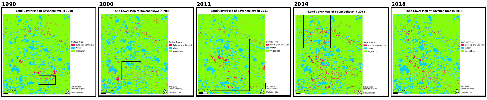
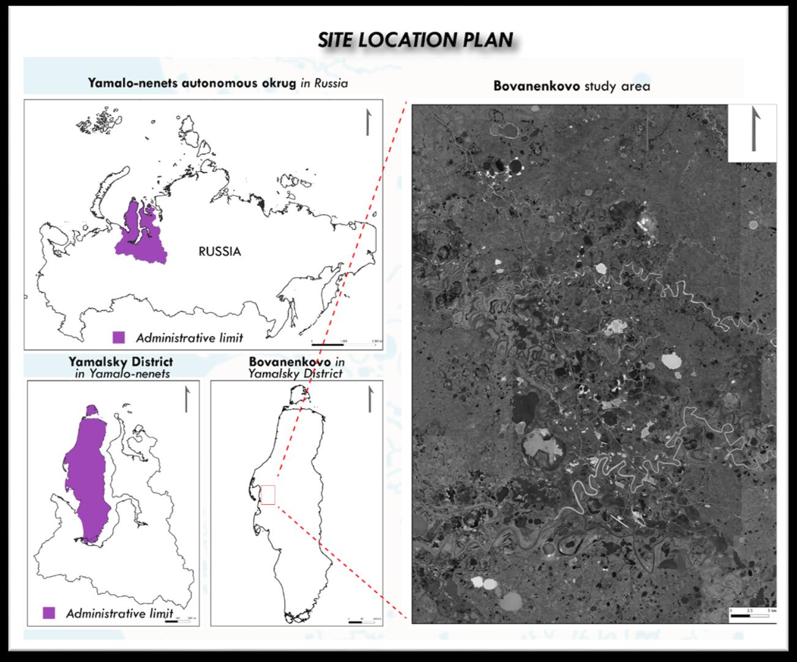
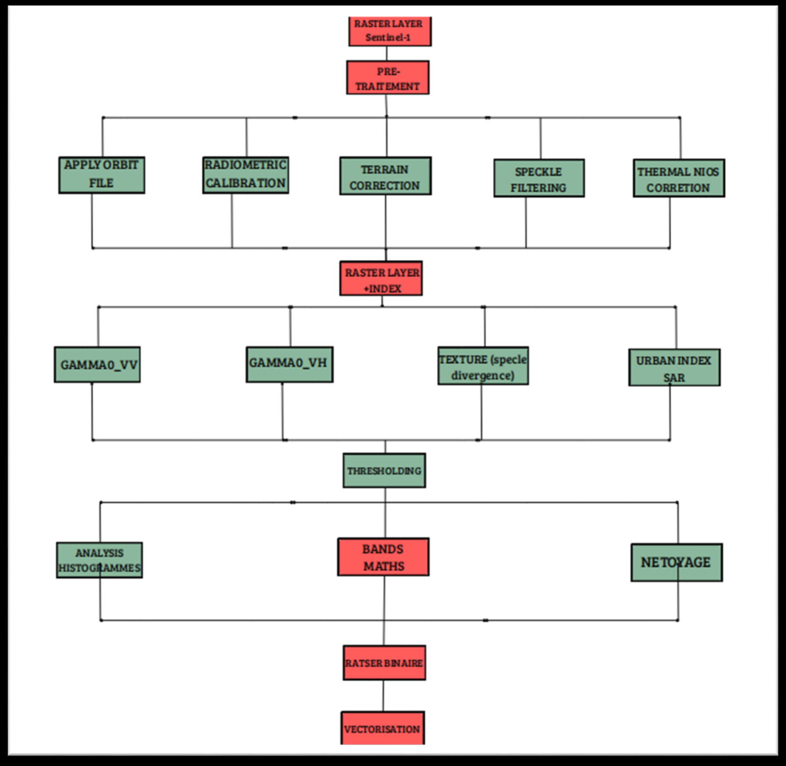
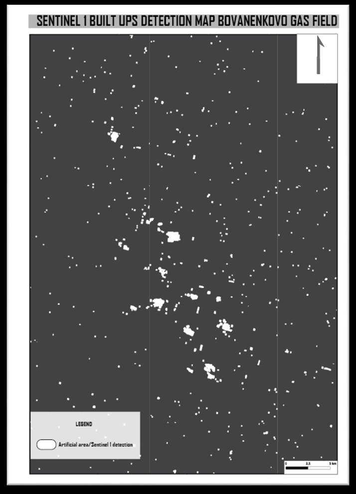
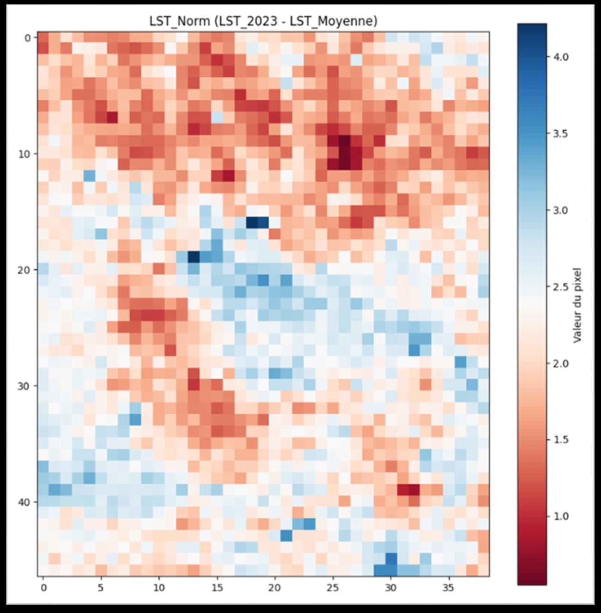
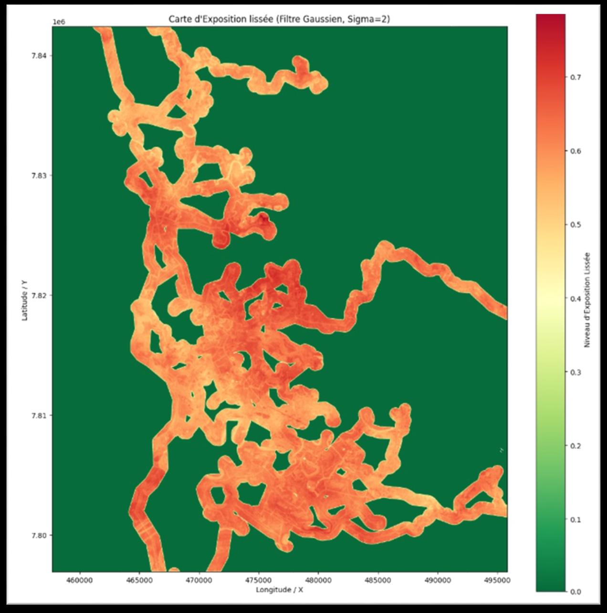
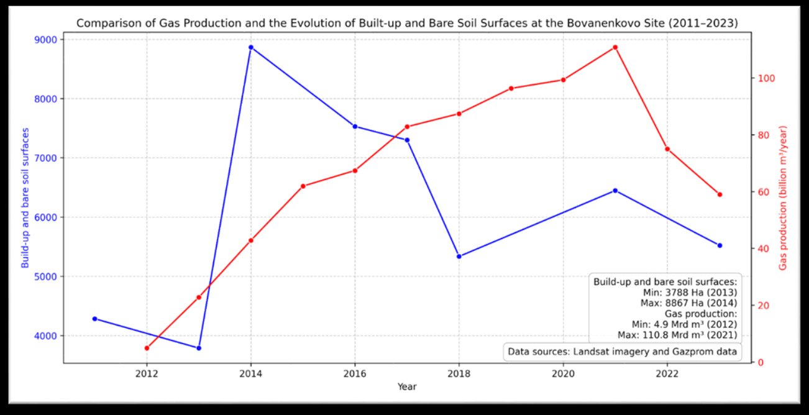
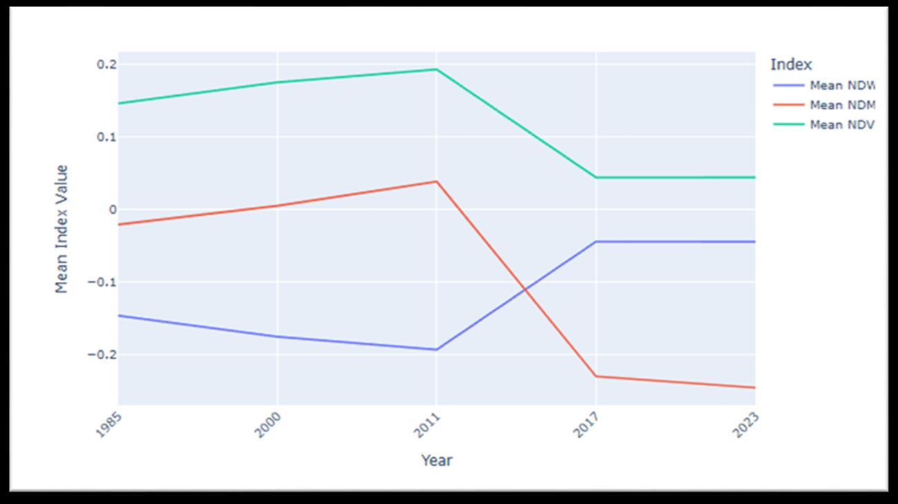
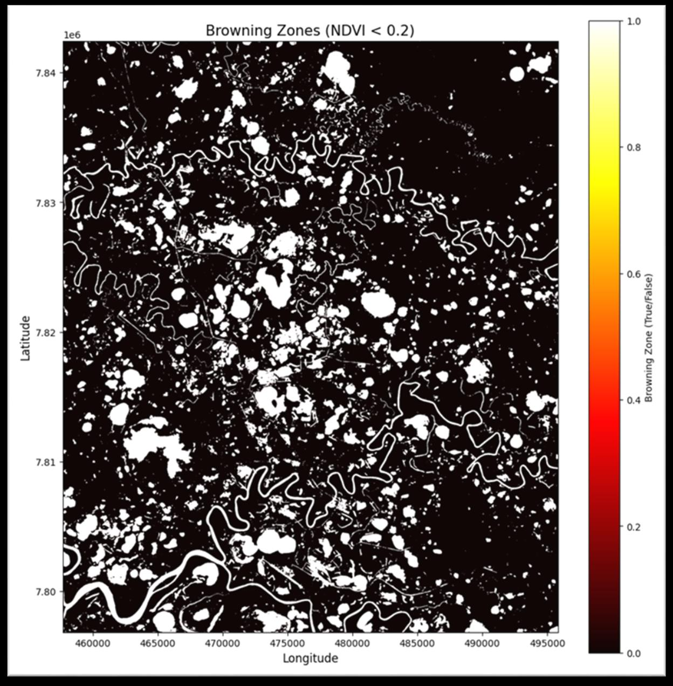

# Paysage arctique et gisement gazier de Bovanenkovo (Russie, 1985-2026)

> Comment l'expansion industrielle d'un gisement gazier transforme-t-elle la toundra et le pergélisol de la péninsule de Yamal ?
> *Multi-sensor analysis (Sentinel-1/2/3/5P, Landsat, ArcticDEM, OSM) of 40 years of Arctic landscape change.*



**Master 1 Géomatique et modélisation spatiale (GMS)**, Aix-Marseille Université · 2025-2026
UE *Geointelligence Applied to Environmental Studies*, sous la direction de Sébastien Gadal
**Travail de groupe (7 étudiants)** : A. Olivier Geoffroy, M.-A. Garchou, M. Jennani, R. Saldani, A. Arhab, A. E. Soukou, A. Bakhoum · Rapport en anglais

---

## Question

*Comment l'expansion industrielle du gisement de Bovanenkovo transforme-t-elle le paysage arctique de la péninsule de Yamal ? Analyse temporelle 1985-2026.*

Zone d'étude : environ 14 × 18 km autour du gisement (UTM 42N, EPSG:32642). Gisement découvert en 1972, chantier lancé en 1988, production depuis 2012.



## Données (multicapteurs)

| Capteur / produit | Résolution | Information extraite | Rôle |
|---|---|---|---|
| **Sentinel-1 SAR** (IW, VV/VH) | 10 m | Rétrodiffusion σ° | Détection des infrastructures |
| **Sentinel-2 MSI** L2A | 10 m | NDVI, MNDWI | Végétation, eau, stress écologique |
| **Sentinel-3 SLSTR** | ~1 km | Température de surface (LST) | Signature thermique, pergélisol |
| **Sentinel-5P TROPOMI** | ~7 km | NO₂, CH₄ | Pollution atmosphérique |
| **Landsat 5 / 7 / 8** | 30 m | Bandes multispectrales | Occupation du sol historique (1985-2018) |
| **ArcticDEM** | 2 m | MNT | Topographie, indice d'humidité (TWI) |
| **OpenStreetMap** | vecteur | Routes, voies ferrées, pipelines | Exposition des infrastructures |

## Méthode



- **Prétraitements** : masque de nuages SCL, reprojection, découpage. Pour le radar (SNAP) : correction d'orbite, calibration, correction de terrain, filtrage du speckle et moyenne estivale.
- **Occupation du sol** : classification non supervisée **ISOCLUST** en 3 classes (bâti / sol nu, végétation, eau) pour 1990, 2000, 2011, 2014 et 2018.
- **Radar** : seuillage de la rétrodiffusion Gamma0 et indice urbain SAR pour isoler les infrastructures.
- **Indices** : NDVI, MNDWI (seuil > 0,20), NDMI, TWI et anomalie de LST, sur cinq dates.
- **Carte de risque combinée** : déformation SAR (60 %) et stress thermique (40 %), puis croisement avec les infrastructures.

## Résultats clés

- **Le bâti est quasi absent en 1990**, puis s'étend fortement à partir de **2008** (routes, plateformes de forage, aéroport, gare). L'emprise se stabilise après 2014.
- **La voie ferrée Obskaya-Bovanenkovo structure tout le système industriel**, ce que confirme l'analyse radar.
- **Il y a un point de bascule environnemental entre 2011 et 2017** : les lacs thermokarstiques s'étendent et l'humidité des sols baisse.
- **La dégradation du pergélisol est maximale là où les infrastructures sont les plus denses**, ce qui forme une boucle de rétroaction.
- **Les infrastructures ont précédé la hausse de production.** La chute de 2022 s'explique par le contexte géopolitique, pas par un seuil environnemental.

| Détection du bâti (Sentinel-1) | Anomalie de LST | Exposition des infrastructures |
|---|---|---|
|  |  |  |



| Évolution des indices (NDVI, NDWI, NDMI) | Zones de brunissement de la végétation (NDVI < 0,2) |
|---|---|
|  |  |

## Perspectives 2026-2050

Trois scénarios sont proposés : réchauffement modéré, dégradation accélérée, effondrement à fort impact. Vu le point de bascule observé, **le scénario de dégradation accélérée** paraît le plus probable sans mesures d'adaptation.

## Outils

`SNAP` · `Google Earth Engine` · `QGIS` · `TerrSet` (ISOCLUST) · `Python` · `QuickOSM`

## Contenu du dépôt

```
├── figures/   localisation, chaîne de traitement, séries temporelles, radar, risques
└── rapport/   rapport complet (PDF, 40 p., anglais)
```

---

**Auteur :** Ezechiel Agbewanou SOUKOU, géomaticien-urbaniste · [LinkedIn](https://www.linkedin.com/in/ezechiel-soukou) · [Autres projets](https://github.com/ezekielofficiel7-spec)
